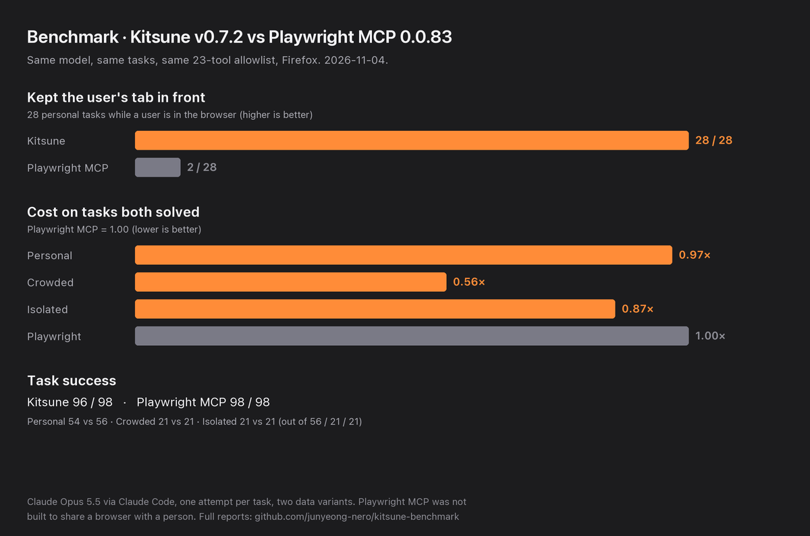

# Kitsune Benchmark

Does an AI agent do everyday browser work as well with **Kitsune MCP** as with **Playwright MCP**, and does it leave
the user's browser alone while it works? This repository runs both on the same tasks, with the same model and tool
allowlist. The results are checked from outside the agent: the apps' saved state, the tabs left behind and the user's
view, along with tokens, time and local CPU/RAM.

**Docs:** [Overview](docs/README.md) · [Running guide](docs/running.md) · [Results](docs/results/README.md) ·
[Results by Kitsune version](docs/results/kitsune-versions.md)

## Latest result: Kitsune v0.7.2

[](docs/results/2026-11-04-opus-subscription-v0.7.2.md)

Claude Opus 5.5 through Claude Code, `taskset-v3.2`, lite plan (two data variants), one run per task, 306 runs
([report](docs/results/2026-11-04-opus-subscription-v0.7.2.md)):

- **The user's view:** Kitsune never moved it in 28 coexistence tasks. Playwright MCP moved it in 26. When the user
  was typing, Kitsune kept their input in 3 of 3 runs and Playwright in 0 of 3.
- **Success:** Playwright 98/98, Kitsune 96/98 on the personal and gallery tasks. Kitsune's two misses are one task,
  `pb-tabs-03`, in two variants. The user's tab stayed in front, but the grader reads Kitsune's `current` tab
  ([#94](https://github.com/junyeong-nero/kitsune-benchmark/issues/94)).
- **Input on tasks both solved, Kitsune / Playwright:** personal 0.985, crowded gallery 0.625, isolated gallery 0.962.
  External MiniWoB++ tasks: 7/7 both.

These are single attempts, so read the differences as observations, not a ranking. Earlier releases:
[v0.7.1](docs/results/2026-10-29-opus-subscription-v0.7.1.md), [v0.7.0](docs/results/2026-10-26-opus-subscription-v0.7.0.md).

## What it measures

| Track | What the agent does | Graded by |
| --- | --- | --- |
| [Personal browsing](docs/personal-browsing.md) | 28 tasks in already-open tabs and a signed-in test session: look things up, fill in drafts, don't submit or close what it shouldn't | The local apps' saved state and the tabs it leaves |
| [Component gallery](docs/gallery.md) | 21 tasks: custom widgets, shadow DOM, iframes, media puzzles and one hand-off, on a crowded page and one at a time | Each task's recorded outcome |
| [Coexistence](docs/coexistence.md) | The personal tasks while a user is in the browser: tabs the user opened, a watched view, a user typing | Personal grading plus the user's view and input |
| [External](docs/external.md) | 7 MiniWoB++ tasks and 3 live sites (Steam, Wikipedia, MDN) | MiniWoB++'s own reward; live tasks are recorded, not graded |
| [Full native](docs/full-native.md) (Kitsune only, not run yet) | 14 of those tasks with Kitsune's own tool groups: `KITSUNE_CAPS=core` vs `all` + the tool gateway, reported apart from the head-to-head | The tracks' own graders, plus gateway use, batch steps and capability errors |
| [Hostile UI](docs/hostile.md) (draft, no model) | 26 real-web components that resist automation | Scripted tool strategies |

The personal and gallery apps are synthetic and local. No real account or everyday browser profile is used.

## Setup

Needs Python 3.11+, uv, Node/npm, Claude Code logged in to a claude.ai subscription, and a Kitsune checkout
(`../kitsune` by default).

```sh
uv sync --locked
npm ci --ignore-scripts --no-audit --no-fund
npm run setup:firefox
```

This pins Playwright MCP `0.0.83`, web-ext `10.8.0` and a private Firefox. Every run gets a fresh profile and its own
Kitsune bridge ports.

## Run

```sh
# Check the CLI and the login; no model calls.
uv run --locked python -m kitsune_benchmark doctor --json

# Plan one task pair; no browser or model calls.
uv run --locked python -m kitsune_benchmark personal --task pb-current-01 --variant 0

# Run it: two agent runs on your subscription. Without --task, --execute runs the six-task pilot (12 runs).
uv run --locked python -m kitsune_benchmark personal --task pb-current-01 --variant 0 --execute

# A release cohort (306 agent runs), then its review.
uv run --locked python scripts/run-full-suite.py --plan lite \
  --kitsune-project artifacts/vendor/kitsune-v0.7.2 --out artifacts/my-suite
uv run --locked python scripts/analyze-release.py artifacts/my-suite
```

By default runs use Claude Code on the subscription: they count against your plan, use no API credit and never fall
back to an API key. API billing (`--harness claude-api --allow-api-billing`) and Codex (`--harness codex`) are opt-in.
The [running guide](docs/running.md) covers every track, budgets, stopping and exit codes.

## Model-free concurrency benchmark

```sh
uv run --locked python -m kitsune_benchmark stress --profile release-v1          # plan only
uv run --locked python -m kitsune_benchmark stress --profile release-v1 --execute
```

One private shared browser, 1–32 MCP clients, three repeats; **no agent/model calls**.
The full-suite script includes this separate track before model work (`--skip-stress`
is the recorded opt-out). It does not change graded task scores or the frozen
taskset. See [protocol and safety limits](docs/stress.md) and the
[first published observation](docs/results/2026-10-26-kitsune-stress-v1.md).

For a fresh, counter-ordered **Kitsune vs Playwright shared-browser comparison**:

```sh
uv run --locked python -m kitsune_benchmark stress-compare --profile shared-browser-v1 --execute
```

This is separate `stress-compare-v1` evidence, not pooled with the standalone
Kitsune track. In a full suite, `--stress-comparison` selects it instead of the
Kitsune-only prelude. See [protocol](docs/stress-comparison.md) and
[paired results](docs/results/2026-10-26-shared-browser-stress-comparison.md).

## Tests

```sh
# No model calls.
uv run --locked python -m unittest discover -s tests

# Real Firefox and both MCP servers, still no model calls.
PERSONAL_BROWSER_TEST=1 PERSONAL_KITSUNE_TEST=1 \
  uv run --locked python -m unittest discover -s tests -p 'test_personal.py'
PERSONAL_BROWSER_TEST=1 PERSONAL_KITSUNE_TEST=1 \
  uv run --locked python -m unittest discover -s tests -p 'test_coexistence.py'
```

## Reading the results

- Look at `scorable` and `task_success` from the grader, not at the exit code or the agent's final answer.
- Input tokens already include cached input. Cost figures are Claude Code's list-price estimate, not what a
  subscription charges.
- Elapsed time includes the harness's own setup calls. The two targets often run at the same time, so time is measured
  under shared load. Summed RSS is not unique memory.
- A result describes a model + harness + MCP configuration on these tasks. Compare Kitsune versions only on the same
  [taskset tag](docs/results/kitsune-versions.md#frozen-taskset).
- Raw logs, profiles and session state stay in the gitignored `artifacts/`. Review them before you share anything.

WebArena-style tasks, real personal accounts and repeated, counterbalanced runs are future work.
