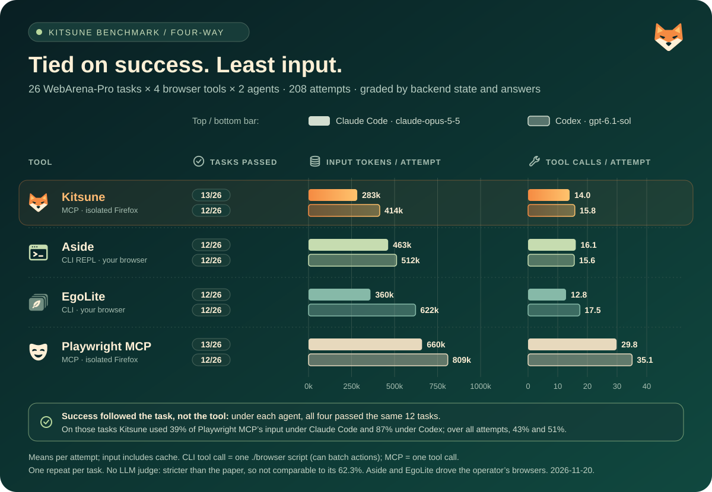

# Kitsune browser benchmark

Four browser tools driven by the same agent on the same 26 [WebArena-Pro](https://github.com/McGill-NLP/webarena-pro) tasks:

| | |
| --- | --- |
| **Tools (arms)** | Aside CLI REPL · EgoLite CLI · Playwright MCP · Kitsune MCP |
| **Agent** | Claude Code on `claude-opus-5-5`, run twice: `claude-api` (API key) first, then `claude` (subscription) |
| **Tasks** | 26 (first 19 test, last 7 dev), one attempt per tool and billing mode |
| **Total** | 26 × 4 × 2 = **208 attempts**, serial; the starting arm rotates by task |

## Quick start

```sh
python3 benchmark.py                                                     # print the plan; no model, browser or site access
python3 benchmark.py --execute --harness claude-api --allow-api-billing  # step 1: 104 API-key cells
python3 benchmark.py --execute --harness claude                          # step 2: 104 subscription cells
python3 -m unittest discover -s tests -v                                 # offline tests
```

Execution needs an agent host, a site host and a few environment variables. Read the [running guide](docs/running.md)
first: it covers setup, billing guards, output handling and measurement rules.

## Latest result

The last published run (2026-11-20) predates the current matrix: it compared Claude Code (subscription) with Codex.

[](docs/results/2026-11-20-webarena-pro-four-way.md)

## Docs

- [Running guide](docs/running.md)
- [Result reports](docs/results/README.md)
- [Documentation index](docs/README.md), including the [archive](docs/archive/README.md) of reports from retired harnesses
